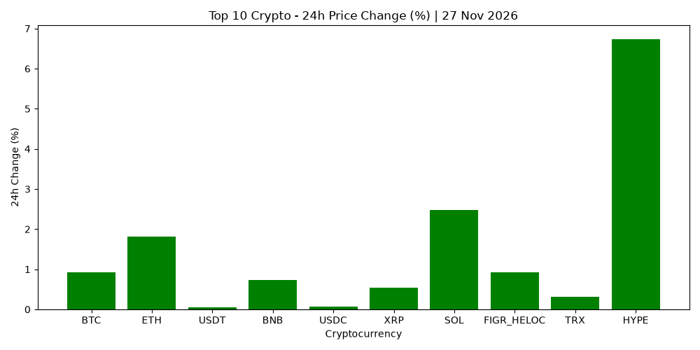

# Automated Daily Crypto Market ETL Pipeline

An end-to-end automated **ETL (Extract, Transform, Load)** data pipeline built with Python and **GitHub Actions**. It fetches live market data for the top 10 cryptocurrencies (in INR) every day at **9:00 AM IST**, stores historical records in an SQLite database, exports the latest snapshot to CSV, and generates an updated visualization chart automatically—even when the local machine is turned off.

---

## Live Daily Market Chart
*(Auto-updated every day at 9:00 AM IST via GitHub Actions)*

---

## Pipeline Architecture
1. **Extract:** Pulls real-time top 10 cryptocurrency market data (price, market cap, 24h percentage change) in INR from the **CoinGecko API**.
2. **Transform:** Uses **Pandas** to clean the dataset, standardize ticker symbols, round percentage changes, and append execution timestamps.
3. **Load:** Appends daily historical records into a local **SQLite database (`crypto_market.db`)** and overwrites the latest snapshot in **`latest_market_data.csv`**.
4. **Visualize:** Generates a color-coded 24-hour performance bar chart (`daily_chart.png`) using **Matplotlib**.
5. **Automate:** Scheduled via **GitHub Actions** (`daily_etl.yml`) to run daily on Ubuntu cloud runners and auto-commit updated outputs back to the repository.

---

## Tech Stack
* **Language:** Python 3.11
* **Data Processing:** Pandas, Requests
* **Database:** SQLite (`sqlite3`)
* **Visualization:** Matplotlib
* **Automation / CI-CD:** GitHub Actions (Cron Scheduler)

---

## Repository Structure
* `etl_pipeline.py` — Main Python ETL and visualization script.
* `requirements.txt` — Python dependencies required for the cloud runner.
* `.github/workflows/daily_etl.yml` — GitHub Actions workflow configuration.
* `crypto_market.db` — SQLite database storing historical daily prices.
* `latest_market_data.csv` — Most recent market snapshot.
* `daily_chart.png` — Auto-generated 24h price change chart.
